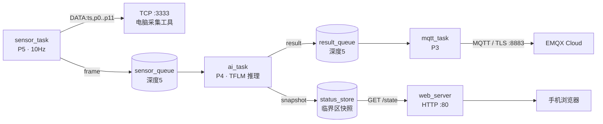

# SleepPosture

**智能床垫睡姿监测系统** —— ESP32-S3 + 12 路 FSR 压力阵列 + 端侧 TinyML，实时识别「仰卧 / 左侧卧 / 右侧卧 / 离床」，经 MQTT(TLS) 上云，并自带局域网网页控制台。


---
## 界面：

手机端无需安装 App——设备与工具均自带局域网网页，浏览器直接访问：

|              实时监视 · 仰卧               |                实时监视 · 左侧卧                 |              实时监视 · 右侧卧              |              实时监视 · 离床               |
| :----------------------------------: | :---------------------------------------: | :----------------------------------: | :----------------------------------: |
| ![[Pasted image 20261025173210.png]] |   ![[Pasted image 20261025173300.png]]    | ![[Pasted image 20261025173249.png]] | ![[Pasted image 20261025173327.png]] |
| ![[Pasted image 20261025173231.png]] | ![[Pasted image 20261025173313.png\|185]] | ![[Pasted image 20261025173253.png]] |                                      |


|            手机遥控采集（选标签 / 开始 / 停止保存）             |
| :--------------------------------------------: |
| ![[0b0207c2109eb4d5704b9d1621772fa6.jpg\|227]] |


---

## 项目简介

本项目把一块 4×3 的 FSR 压力传感阵列做成"智能床垫"，在 **ESP32-S3 上完成从采集、端侧推理到多端输出的完整闭环**：

- **边缘推理**：INT8 量化模型仅 **3.8 KB**，TFLite Micro 在 MCU 内完成推理，不依赖云端算力；
- **状态可信**：用"压力总和闸门"处理离床、用"滑动窗口投票"平滑瞬时误判，输出的是稳定状态而非单帧噪声；
- **全链路可复现**：数据采集 → 训练 → 量化 → C 数组 → 固件内嵌，脚本化、可增量重训；
- **多端一致**：串口 / TCP / MQTT / HTTP 四路输出共用同一个设备端稳定状态，天然一致。

| 关键指标  | 数值                                     |
| ----- | -------------------------------------- |
| 传感阵列  | 12 路 FSR（4×3：肩/背/腰/臀 × 左/中/右）          |
| 采集帧率  | 10 Hz（12 路全阵列扫描，单帧约 19 ms）             |
| 模型    | MLP 12→16→16→3，531 参数                  |
| 量化模型  | INT8，**3928 字节（3.84 KB）**              |
| 训练数据  | 3518 条真实样本（3 类）                        |
| 验证准确率 | **99.86%**                             |
| 通信    | MQTT over TLS(8883)、TCP(3333)、HTTP(80) |
|       |                                        |

---

## 系统架构

### 硬件链路

```
FSR×12 ──分压(10kΩ)──▶ CD74HC4067(16选1) ──SIG──▶ ADS1115(16bit, I2C)
                                                        │ SDA/SCL
                                                        ▼
                                                    ESP32-S3
```

### 软件数据流



### 分层与组件依赖

```
firmware/
├── main/                 app_main.c —— 只负责启动顺序与任务编排
└── components/
    ├── common/           config.h（引脚/参数/枚举/数据结构，全项目唯一配置中心）
    ├── drivers/          mux.c / ads1115.c（寄存器级驱动，业务无关）
    ├── tasks/            sensor.c / ai.cpp / mqtt.c（业务任务）
    ├── network/          wifi_sta.c / tcp_server.c / mqtt_app.c /
    │                     web_server.c / status_store.c / index.html
    └── ai_model/         model_data.c（模型 C 数组）
```

依赖方向单向：`main → tasks → drivers → common`、`tasks → network`。改驱动不动业务，改业务不动驱动。

### 关键设计决策

| 决策 | 做法 | 为什么 |
|---|---|---|
| 并发模型 | 3 任务 + 2 队列，优先级 5/4/3 | 采集是硬周期任务，推理软实时，网络最慢；按"时间敏感度"定优先级 |
| 队列发送 | `xQueueSend(..., 0)` 永不阻塞 | 采集宁可丢帧也不能被下游拖慢，保证 10Hz 节奏 |
| 设备端平滑 | 闸门 + 投票做在固件 | 串口/TCP/MQTT/网页四路输出同源，一致且干净 |
| 规则与模型分工 | 总和阈值判"离床"，模型分姿势 | 分类器是闭集；"有没有人"物理可分性极强（空床总和 5~11 vs 在床万级） |
| 服务端位置 | TCP/HTTP 服务放在设备上 | PC/手机无需开入站端口，设备也无需知道客户端 IP |
| 内存策略 | 模型/arena 全静态，运行期零分配 | 实时性与确定性；TFLM 在预分配 arena 内规划张量 |
| 训练部署一致 | 归一化函数物理复用（`convert.py` import `train.py`） | 训练与推理预处理逐字一致，杜绝"部署漂移" |
| 跨语言 | `ai.cpp` 用 C++，头文件 `extern "C"` | TFLM 是 C++ 库；C 文件（app_main）可直接调用 `ai_task` |

### 任务与队列

| 任务 | 优先级 | 栈 | 周期/触发 | 阻塞在 |
|---|---|---|---|---|
| `sensor_task` | 5 | 6144 | 10 Hz（`vTaskDelayUntil` 自动纠偏） | 延时链表 |
| `ai_task` | 4 | 8192 | 每帧 | `sensor_queue` |
| `mqtt_task` | 3 | 6144 | 每帧取结果，按策略上报 | `result_queue` |

两个队列深度均为 5：生产 10 Hz、消费 <2 ms，正常不会满；深度 5 是抖动缓冲，也是天然限流。

### 端侧推理链路

```
train.py ──▶ .keras ──▶ convert.py ──▶ INT8 .tflite ──▶ to_c_array.py ──▶ model_data.c ──▶ 固件内嵌
```

固件侧 `ai.cpp` 的处理（每个推理帧）：

1. **离床闸门**：12 路总和 < 1000 → 直接输出"离床"，不跑模型；
2. **归一化**：每路 ÷ 本帧最大值（与训练侧 `normalize_rows()` 完全一致）；
3. **量化**：`q = round(x / scale) + zero_point`，写入 int8 输入张量；
4. **Invoke**：TFLite Micro 在 8 KB tensor arena 内完成推理；
5. **取结果**：argmax + 反量化（量化参数运行时从张量读取，换模型不改代码）；
6. **滑动窗口投票**：最近 50 帧（5 秒）多数表决，平票保持当前状态。

### 识别鲁棒性设计

- **离床检测（规则门控）**：模型只见过 3 类姿势，空床输入也会被"强行归类"。用 12 路总和阈值（实测空床 5~11，在床最低数千）做第一级判断，是"规则管可分性、模型管模式"的级联结构。
- **状态平滑（迟滞）**：50 帧滑动窗口投票，瞬时误判（躺下过渡的 1~2 秒）无法翻盘；新状态需赢过窗口一半，切换延迟约 2.5 秒——对睡眠监测是合理取舍，窗口长度可配置。

### 网络设计要点

- **WiFi**：事件回调 + 事件组同步；断线**无限重连**（床边设备需自愈）；断开时清除"已连接"标志；SNTP 对时（TLS 证书校验依赖准确系统时间）。
- **TCP 采集服务器（3333）**：`select()` 同时监视"新连接"与"当前连接"；新客户端自动替换旧连接；互斥锁保护 socket 句柄，遵循"谁拥有谁关闭"（发送失败只 `shutdown`，由 accept 任务统一 `close`）。
- **MQTT（TLS）**：`mqtts://` + 内置 CA 仓库校验；上报策略 = **状态变化即发 + 30 秒心跳**（QoS1），避免 10 Hz 刷屏，同时可判设备存活。
- **HTTP（80）**：`index.html` 通过 `EMBED_FILES` 编译进 Flash；`GET /state` 返回最新结果、三类概率与最近一帧 12 路值，手机页面每秒轮询。

---

## 功能特性

 - 12 路压力 10 Hz 实时采集（16 位 ADC）
 - 端侧 TFLite Micro 推理：仰卧 / 左侧卧 / 右侧卧 / 离床
 - 离床规则闸门 + 50 帧滑动窗口投票
 - WiFi 断线无限重连、SNTP 时间同步
 - MQTT over TLS 上云（状态变化 + 心跳，含三类概率）
 - 设备自带 HTTP 网页（手机查看状态 / 12 路值 / 概率）
 - 局域网网页遥控采集（选标签 / 开始 / 停止并保存）
 - 本地实时监视网页（12 路网格 + 最终判断 + 概率条）
 - 数据驱动的训练流水线（新增数据重跑即可，不改代码）

---

## 硬件

| 器件 | 数量 | 说明 |
|---|---|---|
| ESP32-S3 N16R8 | 1 | 16 MB Flash + 8 MB PSRAM |
| FSR402 薄膜压力传感器 | 12 | 4×3 阵列 |
| CD74HC4067 | 1 | 16 选 1 多路复用，使用 C0~C11 |
| ADS1115 | 1 | 16 位 ADC，I2C 地址 0x48（ADDR 接 GND） |
| 10 kΩ 电阻 | 12 | FSR 分压 |
| 面包板 / 杜邦线 | - | 原型搭建 |

**引脚分配**

| 功能 | GPIO |
|---|---|
| MUX S0 / S1 / S2 / S3 | GPIO4 / 5 / 6 / 7 |
| I2C SDA / SCL | GPIO8 / 9 |
| ADS1115 ADDR / MUX EN | GND |
| 禁用 | GPIO35/36/37（PSRAM 占用） |

分压电路与量程：

```
3.3V ── FSR ──┬── 10kΩ ── GND
              └── Cx（接 MUX 通道）
Vout = 3.3V × 10kΩ / (R_FSR + 10kΩ)
```

ADS1115 采用 ±4.096 V 量程（1 LSB = 125 µV）、860 SPS 单次转换，转换完成通过轮询 OS 状态位确认。

---

## 软件结构

```
SleepPosture/
├── ai/
│   ├── data/                 采集数据（ai/data/<数据集>/*.csv）
│   ├── models/               训练产物（.keras / .tflite / 训练报告）
│   └── scripts/
│       ├── train.py          训练 + 评估 + 报告
│       ├── convert.py        INT8 量化 + 转换后精度验证
│       └── to_c_array.py     .tflite → model_data.c
├── firmware/                 ESP-IDF 工程（见上文组件结构）
├── tools/
│   ├── collect_core.py       采集核心（TCP 连接 / 收帧 / 批次 / 存 CSV）
│   ├── collect_data.py       电脑键盘采集（0/1/2 打标、定时采集、确认保存）
│   ├── web_collect.py        手机遥控采集（局域网网页，端口 8000）
│   ├── web_viewer.py         手机实时监视（12 路值 / 判断 / 概率，端口 8001）
│   ├── idle_sum.py           空载压力总和漂移观察
│   ├── test_tcp.py           TCP 链路最小验证
│   └── pressure_monitor.html 串口版热力图（调试用）
└── docs/images/              README 图片
```

---

## 快速开始

### 1. 编译与烧录

ESP-IDF v5.4：

```bash
cd firmware
idf.py build
idf.py flash monitor
```

- 首次编译会由组件管理器自动下载 `espressif/esp-tflite-micro`（见 `components/tasks/idf_component.yml`）；
- `sdkconfig` 已配置为 **16 MB Flash + 1.5 MB app 分区**（默认 1 MB 分区放不下 WiFi + TLS + TFLM）；
- 串口应输出 WiFi/IP、`模型加载完成: arena 用 N/8192 字节` 与每帧识别日志。

### 2. 配置

- WiFi：`firmware/components/network/wifi_sta.c` 中的 `WIFI_SSID` / `WIFI_PASSWORD`；
- MQTT：`firmware/components/network/mqtt_app.c` 中的 Broker 地址、用户名、密码与主题。

> 公开仓库前请替换为自己的配置，不要把真实凭据提交到 GitHub。

### 3. 使用工具

```bash
# 电脑键盘采集（0/1/2 打标，空格开始/结束，结束时确认保存）
python tools/collect_data.py

# 手机遥控采集：电脑运行后，手机浏览器打开 http://<电脑IP>:8000/
python tools/web_collect.py

# 手机实时监视：电脑运行后，手机浏览器打开 http://<电脑IP>:8001/
python tools/web_viewer.py
```

- `web_collect.py` / `collect_data.py` **不要同时运行**：设备 TCP 采集服务器同一时间只服务一个客户端；
- `web_viewer.py` 走设备 HTTP `/state`，**可与采集工具同时运行**；
- 采集文件保存为 `ai/data/<数据集>/posture_<标签>_<时间>.csv`；
- 设备 IP 由 DHCP 分配，可能变化——建议在路由器做"地址保留"绑定 MAC。

---

## 数据采集与模型训练

### 数据

- 受试者 `zdz`（172.5 cm / 65 kg），单床原型；
- 3 类姿势共 **3518 条**样本（仰卧 1192 / 左侧卧 1133 / 右侧卧 1193），10 Hz 采集；
- 采集工具支持键盘打标、定时采集（5 秒准备倒计时）与批次保存确认。

### 训练

`train.py` 自动扫描 `ai/data/*/` 下全部数据集，丢弃未标注与坏行，按类别分层划分（seed=42），训练 MLP 12→16→16→3（Adam + EarlyStopping），输出 `.keras` 与训练报告。

```bash
python ai/scripts/train.py          # 训练
python ai/scripts/convert.py        # INT8 量化 + 全量数据复核精度
python ai/scripts/to_c_array.py     # 生成 model_data.c
```

**最终一次训练结果**（`ai/models/posture_model_20261025_1616_report.txt`）：

| 项目 | 数值 |
|---|---|
| 样本 | 3518 条（训练 2816 / 验证 702） |
| 验证准确率 | **99.86%** |
| 验证损失 | 0.0040 |
| 量化模型 | 3928 字节（3.84 KB） |

混淆矩阵（行=真实，列=预测）：

| | 仰卧 | 左侧卧 | 右侧卧 |
|---|---|---|---|
| **仰卧** | 237 | 0 | 1 |
| **左侧卧** | 0 | 226 | 0 |
| **右侧卧** | 0 | 0 | 238 |

每类指标：

| 类别 | 精确率 | 召回率 |
|---|---|---|
| 仰卧 | 1.000 | 0.996 |
| 左侧卧 | 1.000 | 1.000 |
| 右侧卧 | 0.996 | 1.000 |

> **说明**：当前验证集与训练集来自同一受试者的同期录制（不同时间段），指标偏乐观；跨人 / 跨床的泛化能力尚未验证，是下一步工作。

---

## 通信协议

| 通道 | 格式 |
|---|---|
| 串口 / TCP `:3333` | `DATA:<开机毫秒>,p0,p1,...,p11\n` |
| MQTT `sleepposture/status` | `{"posture":1,"name":"side_left","confidence":98,"timestamp":123456,"probs":[1,98,1]}` |
| HTTP `/state` | `{"ready":true,"posture":1,"name":"side_left","confidence":98,"timestamp":123456,"probs":[1,98,1],"vals":[p0..p11]}` |

`posture`：0=仰卧，1=左侧卧，2=右侧卧，255=离床；`probs` 为三类概率（0~100，离床帧为 0）。

---

## 引脚连接

|          系统实物          |                        |
| :--------------------: | ---------------------- |
| ![[DSCN4949.jpg\|412]] | ![[DSCN4950.jpg\|411]] |


引脚连接：
ESP32-S3 → CD74HC4067

| ESP32-S3 | CD74HC4067 |
| -------- | ---------- |
| GPIO4    | S0         |
| GPIO5    | S1         |
| GPIO6    | S2         |
| GPIO7    | S3         |
| 3.3V     | VCC        |
| GND      | GND        |
| GND      | EN         |

## ESP32-S3 → ADS1115

| ESP32-S3 | ADS1115 |
|----------|---------|
| 3.3V | VCC |
| GND | GND |
| GPIO8 | SDA |
| GPIO9 | SCL |
| GND | ADDR |

## CD74HC4067 → ADS1115

| CD74HC4067 | ADS1115 |
|------------|---------|
| SIG | A0 |

## FSR分压电路 → CD74HC4067

| FSR | 分压中间节点接 |
|-----|--------------|
| FSR0 | C0 |
| FSR1 | C1 |
| FSR2 | C2 |
| FSR3 | C3 |
| FSR4 | C4 |
| FSR5 | C5 |
| FSR6 | C6 |
| FSR7 | C7 |
| FSR8 | C8 |
| FSR9 | C9 |
| FSR10 | C10 |
| FSR11 | C11 |

分压电路：
```
3.3V ── FSR ──┬── 10kΩ ── GND
              └── Cx
```

---

## END

个人学习与求职作品，代码仅供学习交流参考。
